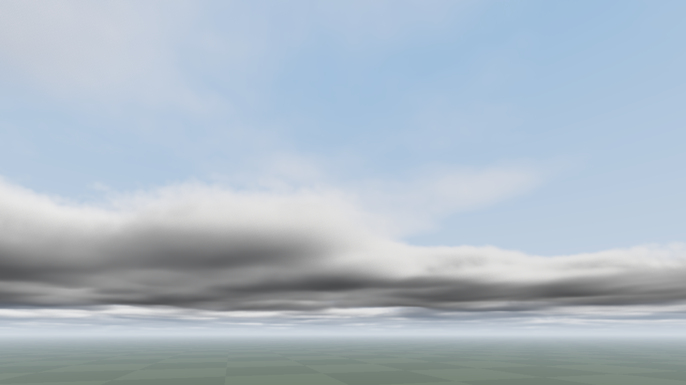
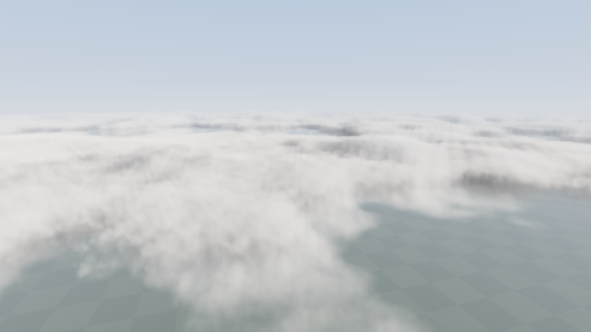
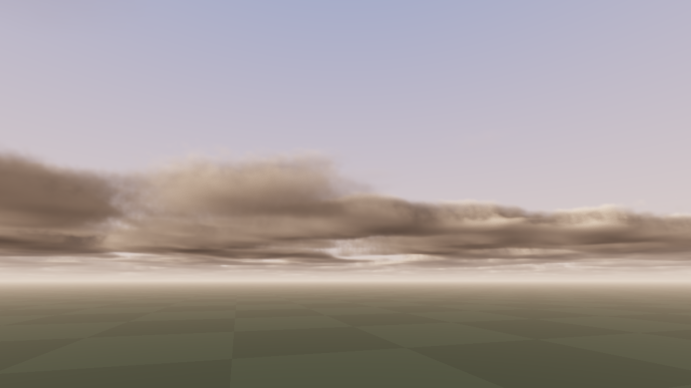

# Volumetric Cloud Renderer

Real-time procedural clouds in C++17 and OpenGL 4.5. A fragment shader ray-marches a spherical cloud layer built from tileable 3D Perlin-Worley noise, lights it with a multiple-scattering approximation, and a temporal pass reprojects each frame against the last one so the march can run at half or quarter resolution without visible noise.

It runs interactively through GLFW, or headless through surfaceless EGL on Linux, which is how the images below and the CI render are produced (on Mesa's CPU rasterizer, no GPU needed).





## What's in it

**Cloud model.** A 128³ shape texture (Perlin fbm dilated by Worley, plus three Worley octaves) and a 32³ Worley detail texture, both generated on the GPU by compute shaders at startup and tileable so the layer extends to the horizon. A 512² weather map gives coverage and cloud type per region. Cloud type picks a vertical density profile (stratus, cumulus, cumulonimbus), and the detail texture erodes the edges of the base shape, with less erosion where coverage is high so solid decks stay solid. Wind scrolls the noise over time with a little shear by height.

**Lighting.** Each march step takes six samples toward the sun to get optical depth, then evaluates a four-octave multiple-scattering approximation (attenuated extinction, contribution and phase eccentricity per octave, after Wrenninge and Hillaire) with a two-lobe Henyey-Greenstein phase function. A powder term darkens back-lit edges, and an ambient term fades from blue at the top of the layer to grey at the bottom. In-scattering is integrated analytically over each step so the result does not depend on step size. The sun and sky colour shift warm as the sun nears the horizon.

**Marching.** Rays intersect a spherical shell around the planet, so the layer curves away at the horizon and the camera can be below, inside or above it. Step size is derived from the ray's span through the layer. Steps are jittered per pixel with interleaved gradient noise that changes each frame, and the march stops once transmittance drops below 0.5%. The pass writes radiance, transmittance and a transmittance-weighted mean depth.

**Temporal reprojection.** The cloud pass renders at a reduced resolution with a sub-pixel jitter from a Halton sequence. A resolve pass reconstructs the world position of each full-resolution pixel from the cloud depth, projects it through the previous frame's view-projection matrix, and blends the history sample in at 92%. The history is clamped to the 3×3 neighbourhood of the current sample so disocclusions and lighting changes do not ghost. The jitter means the half-resolution samples land on different sub-pixel positions each frame, so they converge to a full-resolution result over roughly a dozen frames.

**Tooling.** Per-pass GPU timings with timer queries (shown in the window title), a `--bench` mode that times several configurations, `--headless` rendering to PNG, F5 shader hot-reload, and a debug view of the noise textures.

## Performance

`--bench` times each pass over a window of frames. These numbers are from Mesa llvmpipe (a CPU rasterizer) at 640×360, so the absolute values are meaningless. The ratios are the point: half-resolution with reprojection costs 29% of the full-resolution march for a result that converges to the same image.

| configuration | cloud pass | resolve | composite | total |
|---|---|---|---|---|
| full-res, 128 steps, no temporal | 899 ms | 13 ms | 15 ms | 927 ms |
| full-res, 64 steps, no temporal | 468 ms | 8 ms | 15 ms | 490 ms |
| half-res, 128 steps, temporal | 221 ms | 27 ms | 18 ms | 266 ms |
| quarter-res, 128 steps, temporal | 81 ms | 30 ms | 13 ms | 124 ms |

Run `clouds --bench --size 1920x1080` on a GPU for real numbers.

## Build

Needs CMake 3.20+, a C++17 compiler, GLFW 3.3 and an OpenGL 4.5 driver. Headless mode also needs Mesa's EGL (`libegl1-mesa-dev`, `libgl1-mesa-dri`).

```bash
# Linux
sudo apt install cmake libglfw3-dev libegl1-mesa-dev libgl1-mesa-dev libgl1-mesa-dri
cmake -B build -DCMAKE_BUILD_TYPE=Release && cmake --build build -j
./build/clouds                       # interactive
./build/clouds --headless --out clouds.png
./build/clouds --bench
```

```powershell
# Windows (GLFW via vcpkg)
vcpkg install glfw3
cmake -B build -DCMAKE_TOOLCHAIN_FILE=%VCPKG_ROOT%/scripts/buildsystems/vcpkg.cmake
cmake --build build --config Release
build\Release\clouds.exe
```

Shaders are read at runtime from `./shaders`, or wherever `--shaders` points.

## Controls

| key | |
|---|---|
| mouse, W A S D, Q E | look, move, down/up (Shift to move faster) |
| Z / X | coverage |
| C / V | density |
| B / N | cloud type (stratus to cumulonimbus) |
| O / P, K / L | sun azimuth, sun elevation |
| 1 / 2 / 3 | cloud pass at full / half / quarter resolution |
| T | toggle temporal reprojection |
| H | show the noise textures |
| Space | pause the wind |
| R | reset weather |
| F5 | reload shaders |
| F12 | save screenshot.png |

Headless options: `--size WxH`, `--frames N` (frames to accumulate before saving), `--cam X,Y,Z --yaw --pitch`, `--move X,Y,Z` (per-frame camera motion, for testing reprojection), and the weather flags `--coverage --density --type --sun-el --sun-az`. `--help` lists everything.

## Layout

| path | |
|---|---|
| `shaders/clouds.frag` | density model, lighting, ray march |
| `shaders/resolve.frag` | temporal reprojection and neighbourhood clamp |
| `shaders/composite.frag` | sky, sun, ground, tone mapping |
| `shaders/noise_*.comp`, `weather.comp` | noise texture generation |
| `src/renderer.cpp` | passes, render targets, timer queries |
| `src/context.cpp` | GLFW window or surfaceless EGL context |
| `src/gl.h` | the GL function loader |

## Limitations

- One cloud layer. No cirrus, no separate high layer.
- Sky is an analytic gradient, not an atmosphere model, so the sun's colour at low elevation is hand-tuned.
- The multiple-scattering octaves are an approximation; the lit side of thick clouds is somewhat flatter than in a path-traced reference.
- Reprojection uses the mean cloud depth per pixel. Where a thin near cloud overlaps a far one, that depth is a compromise and the history clamp does the rest.

## References

- Schneider and Vos, *The Real-time Volumetric Cloudscapes of Horizon: Zero Dawn*, SIGGRAPH 2015
- Hillaire, *Physically Based Sky, Atmosphere and Cloud Rendering in Frostbite*, SIGGRAPH 2016
- Wrenninge, Kulla and Lundqvist, *Oz: The Great and Volumetric*, SIGGRAPH 2013 talks
- Högfeldt, *Convincing Cloud Rendering*, 2016
